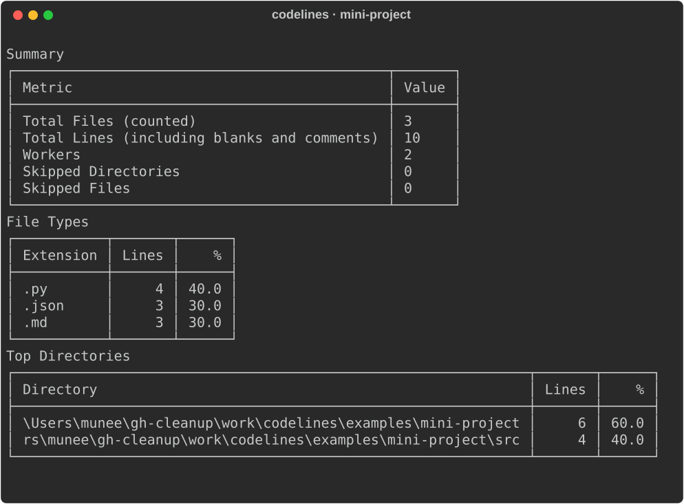
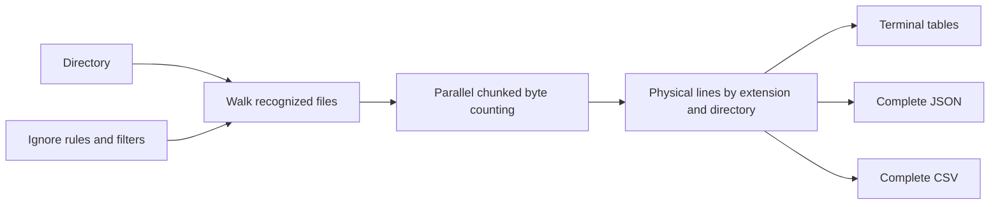

<div align="center">

# codelines

**See where the lines in a project live.**

A physical line counter with readable terminal tables and complete JSON/CSV reports.

[](https://pypi.org/project/codelines/) [](pyproject.toml) [](https://github.com/Muneer320/codelines/actions/workflows/ci.yml) [](LICENSE)

[**Install and count**](#install-and-count) · [**Try the sample**](#a-small-project-you-can-check-by-hand) · [**Library use**](#library-use)

</div>

## A quick map of a codebase

When you open an unfamiliar repository, it helps to know how its source is distributed. codelines groups physical lines by extension and directory, follows ignore rules, and gives the same underlying counts to a terminal reader or a script consuming JSON/CSV.



*Real CLI output exported as SVG. These are the fixture's counts, not a benchmark or a claim about this repository's total size. Directory paths reflect the capture machine.*

| Read the overview | Fit the repository | Automate the report |
| --- | --- | --- |
| Extension and directory tables with configurable sorting | Nested `.gitignore`/`.ignore`, default dependency skips and depth/extension filters | Full JSON and CSV on stdout; diagnostics on stderr |

> [!NOTE]
> **Physical lines include blank lines and comments.** This is not a language-aware statement counter or a measure of code quality, developer productivity or effort. NUL-containing files contribute zero lines.

## Install and count

Requires Python 3.9+. CI checks Python 3.9 and 3.13 on Ubuntu 24.04 and Windows.

```sh
python -m pip install codelines
codelines --version
codelines .
```

Run the last command from the directory you want to inspect. The terminal shows total files/lines and breakdowns by extension and directory. No account, service or API key is required.

```sh
codelines . --format json > count.json
codelines . --format csv > count.csv
codelines . --include .py .rs --max-depth 2
codelines . --sort-by ext --top 10
```

Table limits do not truncate machine-readable reports. `--quiet` suppresses status/progress while retaining the report; JSON/CSV already keep stdout free of progress messages. Report paths can identify local directories, so review exports before publishing them.

## A small project you can check by hand

The included [mini-project](examples/mini-project) contains three recognized files:

```text
mini-project/
├── README.md       3 lines
├── config.json     3 lines
└── src/greet.py    4 lines
                   ────────
                   10 lines
```

After installing the package above, clone this repository to reproduce the example:

```sh
git clone https://github.com/Muneer320/codelines.git
cd codelines
codelines examples/mini-project --quiet --workers 2
codelines examples/mini-project --format json --workers 2
```

The JSON summary reports `total_files: 3` and `total_lines: 10`; extension totals are `.py: 4`, `.json: 3`, `.md: 3`. Directory keys use absolute paths and will differ on your machine. A file's final line counts even without a terminating newline.

## How counting works



The scanner recognizes common source/text extensions and special filenames including `Dockerfile`, `Makefile` and `CMakeLists.txt`. Counting uses worker threads and chunked reads. No throughput benchmark is asserted.

<details>
<summary><strong>Ignore behavior, sorting, depth and file recognition</strong></summary>

The table is for terminal reading.JSON and CSV contain every extension and directory, regardless of `--top`, and write only the result to stdout. `--quiet` suppresses status and progress while keeping the report. Errors go to stderr.

`--max-depth 0` scans root files; depth 1 also scans direct child directories. `--sort-by lines` orders each group by descending line count. `--sort-by ext` orders extensions alphabetically; `--sort-by dir` orders directories alphabetically. `--top` limits only table rows.

The scanner reads `.gitignore` and `.ignore` in the root and nested directories, with Git-style negation and anchored patterns. It skips common dependency, cache, build and VCS directories by default, including `node_modules`, `.venv`, `__pycache__`, `dist` and `.git`. Use `--no-default-ignores` to disable that built-in list; ignore files still apply. `--ignore-file PATH` adds another ignore file.

Known extensions include Python, JavaScript, TypeScript, Rust, Go, Java, HTML, CSS, JSON, Markdown and YAML. Files named `Dockerfile`, `Makefile` and `CMakeLists.txt` are also counted. `--include` and `--exclude` filter by extension; `--include` can also name a recognized filename.

Use `codelines --help` for the complete CLI. Unrecognized files are excluded; unreadable files return zero rather than a complete semantic inventory of their contents.

</details>

## Library use

```python
from pathlib import Path
from codelines.ignore import IgnoreMatcher
from codelines.scanner import collect_files
from codelines.counter import count_lines

root = Path(".").resolve()
files, skipped_dirs, skipped_files = collect_files(root, IgnoreMatcher(root))
total, by_extension, by_directory = count_lines(files)
```

Library functions do not print progress unless `verbose=True` is passed.

The tuple contains total physical lines, extension totals and directory totals. These are module-level APIs; the documented imports match the current source. The CLI remains the shortest way to produce a report.

## Develop and contribute

From the cloned repository:

```sh
python -m pip install -e ".[dev]"
python -m pytest
```

Open an [issue](https://github.com/Muneer320/codelines/issues) with the command, platform and a small reproducible directory. For a focused PR, run the tests and update examples when flags or counting rules change. Use generated fixtures and avoid attaching private source trees or machine reports containing sensitive paths.

Created by [Muneer Alam](https://github.com/Muneer320). Released under [MIT](LICENSE).
